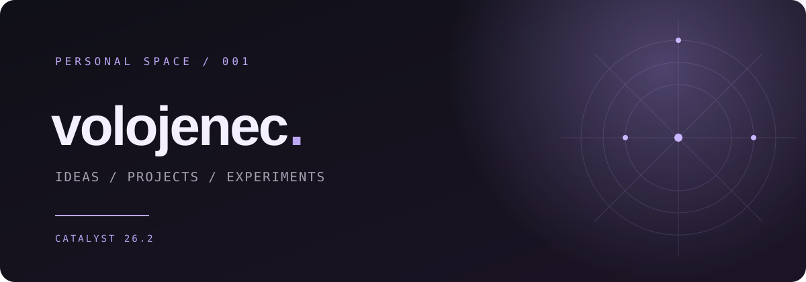

  

 

### Привет, я **volojenec** 💮

Здесь появляются мои идеи, проекты и эксперименты. 
Люблю создавать новое и превращать задумки во что-то реальное.

 

`✦` &nbsp; **CATALYST 26.2** &nbsp; · &nbsp; скоро

 

 

✦ &nbsp; made with curiosity &nbsp; ✦

